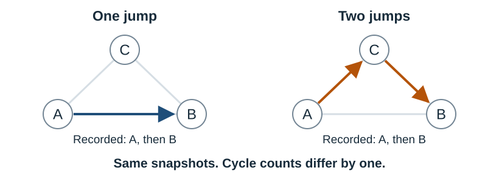
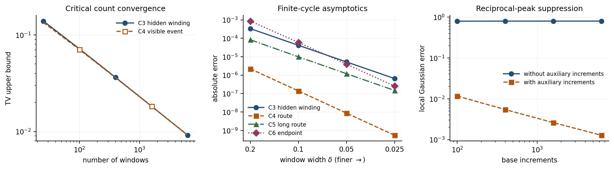

# Homological Observability

Homological Observability is a Python toolkit for studying which accumulated
cycle histories can be recovered from discrete observations of a known
finite-state Markov jump network. Given a network and optional integer
counters, it computes the hidden cycle directions and their asymptotic
sampling requirements. With transition rates, it also constructs the
critical-limit experiment.

The toolkit implements methods and finite-cycle calculations from
*Stochastic Histories at Finite Temporal Resolution: Homological Observability
and Information Phase Diagrams in Markov Jump Processes*. You can reproduce
the paper's calculations or apply the methods to your own networks through
the command line and Python API.

The companion manuscript is not yet publicly available. An arXiv link will
be added here when the preprint is posted.

[Get started](#install-from-a-source-checkout) ·
[Worked example](#guided-example-a-wedge-of-c3-and-c5) ·
[Your own network](#analyze-your-own-network) ·
[Python API](#python-api) ·
[Reproduce the paper](#reproduce-the-paper-evidence)

## Why homological observability?

Imagine a particle moving among three wells arranged around a ring, described
by a three-state Markov jump model. A detector records only the occupied well
every $\delta$ units of time. A pair of snapshots showing A and then B is
compatible with a direct jump A → B or two jumps A → C → B. The two histories
differ by one winding around the ring, but the snapshots are identical.



Knowing the transition rates gives probabilities to these alternatives; it
does not reveal which history occurred. Even at equilibrium, with equal
forward and reverse rates and zero mean cycle current, this ambiguity remains.
The quantity to recover is the accumulated integer cycle displacement of an
actual run, relative to a fixed endpoint reference.

Longer observation produces more snapshots **and a longer history to recover**.
For the triangle, a two-jump alternative has probability of order $\delta^2$
per window. Across about $T/\delta$ windows, its cumulative scale is $T\delta$.
On general networks, different cycle directions enter at different orders,
giving the scales $T\delta^{m-1}$. Times here are measured in a fixed reference
rate's inverse units.

The software identifies these layers and computes how additional counters
change the hidden history and its sampling requirements. The
[physical interpretation](docs/SCIENTIFIC_SCOPE.md) develops the observation
problem and its research uses.

## Install from a source checkout

Use Python 3.11–3.13. Clone the repository and enter its root directory:

```bash
git clone https://github.com/yeruciwenrou-dotcom/homological-observability.git
cd homological-observability
```

You can also download and extract the repository ZIP, then open a terminal
in the directory containing `quickstart.py`. To verify the paper calculations,
go directly to [reproduction](#reproduce-the-paper-evidence); that command
handles installation as well.

For a first analysis, install the package and run the built-in example.
On macOS or Linux:

```bash
python3 -m venv .venv
.venv/bin/python -m pip install .
.venv/bin/homological-observability example wedge-c3-c5
```

On Windows PowerShell:

```powershell
py -3.12 -m venv .venv
.venv\Scripts\python.exe -m pip install .
.venv\Scripts\homological-observability.exe example wedge-c3-c5
```

Python 3.11 or 3.13 can be selected in place of 3.12. These commands use the
virtual environment directly, so activation is optional. The first installation
needs internet access. CI covers Ubuntu and Windows; the source installation
also works on macOS.

## Guided example: a wedge of C3 and C5

The example joins a triangle and a five-cycle at one state. An extra counter
measures $2n_3+n_5$, where $n_3$ and $n_5$ are the two cycle-history
coordinates. Its value reveals the parity of $n_5$, while histories differing
by $(-1,2)$ give the same reading.

The command above returns `COMPLETE`. Its key results are:

| Layer $m$ | Newly exposed cycle | Visible quotient | Hidden free rank added |
| ---: | --- | --- | ---: |
| 2 | Triangle | $\mathbb Z$ | 0 |
| 3 | Five-cycle | $\mathbb Z/2\mathbb Z$ | 1 |

At layer two, the counter resolves the triangle direction. At layer three,
the visible image grows from $2\mathbb Z$ to $\mathbb Z$: the new odd class
gives the quotient $\mathbb Z/2\mathbb Z$. Ordinary real rank would miss this
change. The combination $(-1,2)$ remains hidden and first appears at this layer.

This changes the sampling requirement for recovering the full cycle history.
With snapshots alone, $T\delta\to0$ suffices. With the weighted counter, the
weaker condition $T\delta^2\to0$ suffices. The example requests
$\delta=T^{-1/2}$, placing its remaining hidden direction at criticality.

The [end-to-end guide](docs/END_TO_END_EXAMPLE.md) compares snapshots alone,
the weighted counter, and separate counters for the two cycles. It also
explains the terminal output and provides the full
[JSON](examples/wedge_c3_c5_result.json) and
[Markdown](examples/wedge_c3_c5_result.md) results.

For a general graph, the same calculation constructs the integer cycle
lattice $\Lambda=H_1(G;\mathbb Z)$, the exposure layers $L_m$, their visible
images $\pi(L_m)$, and the hidden lattices $K_m=L_m\cap\ker\pi$.
Their successive quotients retain both free directions and finite-index
information. See [conventions](docs/CONVENTIONS.md) for the definitions.

## Analyze your own network

Save this model as `triangle.json` in the repository root:

```json
{
  "schema_version": 1,
  "name": "triangle",
  "vertices": ["a", "b", "c"],
  "edges": [["a", "b"], ["b", "c"], ["a", "c"]],
  "analysis": {"max_cycles": 10000}
}
```

Run a text summary or request JSON for further processing:

```bash
.venv/bin/homological-observability analyze triangle.json
.venv/bin/homological-observability analyze triangle.json --format json
```

<details>
<summary>Windows PowerShell</summary>

```powershell
.venv\Scripts\homological-observability.exe analyze triangle.json
.venv\Scripts\homological-observability.exe analyze triangle.json --format json
```

</details>

The graph must be finite, connected, undirected, and simple. Add integer edge
readouts to describe extra counters. Optional settings specify a maximum
layer, an asymptotic exponent `alpha`, or the finite-scale pair
`observation_time` and `sampling_interval`. The
[model guide](docs/MODEL_GUIDE.md) explains the fields and gives a complete
model with a readout.

Cycle enumeration can grow exponentially with the network. The example sets
an explicit `max_cycles` budget; omitting it leaves enumeration unbounded by
the application. Choose a budget when trying an unfamiliar graph. If it is
exhausted, the analysis returns `LIMIT_REACHED` and identifies the limit.

`COMPLETE` means the requested layers were computed and the exposure lattice
has reached all of $H_1(G;\mathbb Z)$. A shorter requested horizon that has
not reached that lattice returns `PARTIAL_HORIZON`; its computed layers remain
exact. The wedge example is already complete at layer three.

## Construct a rate-dependent critical experiment

The `critical` command adds known positive directed rates and constructs the
exact path catalogue, stationary law, graded marks, and marked-Poisson
experiment at a selected layer. Run the supplied nonreversible four-cycle:

```bash
.venv/bin/homological-observability critical examples/biased_c4_critical.json
```

<details>
<summary>Windows PowerShell</summary>

```powershell
.venv\Scripts\homological-observability.exe critical examples/biased_c4_critical.json
```

</details>

Before the extra readout is applied, the two antipodal path marks have exact
conditional probabilities $4/5$ and $1/5$. The
[biased C4 guide](docs/CRITICAL_EXPERIMENT.md) explains how rates and counters
affect the uncertainty, and walks through the complete
[JSON result](examples/biased_c4_critical_result.json).
Add `--format json` to obtain this result from the command line.

This experiment describes the critical limit $T\delta^{m-1}\to\theta$.
Evaluating a posterior at finite $(T,\delta)$ requires a separate calculation.

## Python API

Use the virtual environment's Python interpreter for this example. The model
is included in the installed package, so it can be loaded from any directory:

```python
import homological_observability as ho

model = ho.load_example("wedge-c3-c5")
result = ho.analyze_model(model)
print(ho.render_text(result))
```

This prints the same analysis table as the command-line example. Use
`ho.load_model("triangle.json")` for a model file and
`ho.analysis_to_dict(result)` to work with the structured result in Python.
The API also exposes critical experiments, schemas, and JSON renderers;
topology analyses can be rendered as Markdown. The
[output guide](docs/OUTPUT_CONTRACT.md) describes the fields.

## Scope and interpretation

The graph and readouts specify an observation model. The Markov interpretation
assumes positive transition rates in both directions on every edge. Rate
magnitudes are needed for critical path probabilities; the graph filtration
only needs their support. The paper's statistical results use a fixed graph,
generator, and readout, a stationary initial law, and regular noiseless vertex
snapshots with exact integer counters.

Lattice operations and finite catalogues are exact when the calculation
completes. Phase labels, entropy coefficients, and sampling exponents apply
the paper's long-time asymptotic results. A finite-run error tolerance calls
for additional risk analysis of the chosen observation model. The
[scientific scope](docs/SCIENTIFIC_SCOPE.md) gives the full assumptions and
interpretation, and the [paper map](PAPER_MAP.md) connects the implemented
objects to the manuscript.

## Reproduce the paper evidence

From the source directory, run:

```bash
python3 quickstart.py
```

On Windows:

```powershell
py -3.12 quickstart.py
```

The script installs pinned dependencies, runs the reader-side test suite,
and reproduces the frozen paper calculations. It manages the repository's
`.venv`, reusing it for the same Python version and recreating it when the
interpreter's major or minor version changes. Keep any separately managed
environment in another directory. Installation needs internet access.

A successful run confirms that the generated tables agree with the committed
references. Open `generated_results/REPORT.md` for the scientific summary and
`generated_results/companion_summary.png` for the figure. Fresh outputs are
kept separate from the reference files in `results/`.

To repeat only the calculations in an installed environment, run:

```bash
.venv/bin/homological-observability reproduce --check --output-dir generated_results
```

<details>
<summary>Windows PowerShell</summary>

```powershell
.venv\Scripts\homological-observability.exe reproduce --check --output-dir generated_results
```

</details>

Reference acceptance uses the documented numerical tolerances. File hashes
identify a particular run's outputs; see the
[output guide](docs/OUTPUT_CONTRACT.md#artifact-roles) for comparison details.

The frozen calculations cover symmetric C3–C6 bridge posteriors, C3/C4
critical kernels, the Poisson-averaged binomial MAP identity, and the
reciprocal-lattice peak mechanism. The [report](results/REPORT.md) explains
the distinction between an unseen winding and a visible opportunity with an
unknown route. The figure shows approximation errors in the corresponding
limiting descriptions.



### Finite-ring bridges

To inspect the path ambiguity in a single window, run:

```bash
.venv/bin/python explore_cycles.py --cycle 4 --residue 2 --delta 0.1
```

<details>
<summary>Windows PowerShell</summary>

```powershell
.venv\Scripts\python.exe explore_cycles.py --cycle 4 --residue 2 --delta 0.1
```

</details>

This prints winding probabilities given opposite-vertex snapshots on a
symmetric four-state ring. The two shortest routes have equal weight. The
table also reports the probability mass covered by the displayed range.

## Documentation and feedback

| Document | What you will find |
| --- | --- |
| [Physical interpretation](docs/SCIENTIFIC_SCOPE.md) | Observation problem, research uses, and assumptions |
| [End-to-end example](docs/END_TO_END_EXAMPLE.md) | Compare counters and interpret their sampling requirements |
| [Critical experiment](docs/CRITICAL_EXPERIMENT.md) | Rate-dependent path competition and the effect of a readout |
| [Model guide](docs/MODEL_GUIDE.md) | Input fields, validation, resource controls, and examples |
| [Output guide](docs/OUTPUT_CONTRACT.md) | Result fields, statuses, formats, and exit codes |
| [Conventions](docs/CONVENTIONS.md) | Orientations, coordinates, integer filtrations, and phase laws |
| [Numerical methods](docs/NUMERICS.md) | Probability evaluation, range limits, and reference calibration |
| [Paper map](PAPER_MAP.md) | Connections between paper objects, algorithms, examples, and tests |
| [Changelog](CHANGELOG.md) | Changes by software version |

Use [Issues](https://github.com/yeruciwenrou-dotcom/homological-observability/issues/new/choose)
to report a problem or discuss a research use. The
[contribution guide](CONTRIBUTING.md) explains how to prepare and check changes.

## Citation and license

Cite the companion paper for theoretical results and the software for
computations performed with this package. Record the software version and,
for a source checkout, the exact Git commit. [`CITATION.cff`](CITATION.cff)
contains both entries; GitHub's citation menu displays the paper. The paper,
*Stochastic Histories at Finite Temporal Resolution: Homological Observability
and Information Phase Diagrams in Markov Jump Processes*, is not yet publicly
available. Public release on arXiv is planned.

Software authors: HongZheng Liu, YiNuo Tian, Zhiyue Wu, and Jianqun Cheng.

The software is available under the [MIT License](LICENSE). The manuscript
has its own copyright and licensing status.
