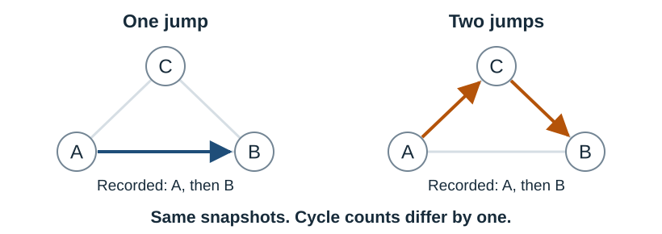

# Homological Observability

[](https://pypi.org/project/homological-observability/2.1.0/)
[](https://doi.org/10.5281/zenodo.24058140)
[](https://www.alphaxiv.org/abs/2610.homological-observability-markov-jump-processes)

**Homological observability is the recoverability of a system's accumulated
cycle history from observations with finite temporal resolution.**

This repository provides **computational tools for homological observability**,
including exact integer calculations and reproducible finite-model examples.
Use it to identify hidden cycle information in your network, compare recording
schemes, and determine which counts recover a chosen trajectory target.
With an observed record and known transition rates, you can also estimate the
probability of each possible target value and compare the error from different
snapshot schedules and counters.

> **Paper:** Liu, H., Tian, Y., Wu, Z., & Cheng, J. (2026).<br>
> *Stochastic Histories at Finite Temporal Resolution: Homological Observability
> and Information Phase Diagrams in Markov Jump Processes*.<br>
> [Read and discuss the paper on alphaXiv](https://www.alphaxiv.org/abs/2610.homological-observability-markov-jump-processes)

[Install](#install) · [Quick start](#quick-start) · [Python API](#python-api) ·
[Documentation](#documentation-and-feedback)

## Choose a task

| Your research question | Start here |
| --- | --- |
| What does finite temporal resolution hide about physical motion? | [Physical interpretation](#physical-interpretation) |
| Which target values fit my measured record, and how likely is each? | [Infer a target from your own record](docs/FINITE_RECORDS.md#use-your-own-model) |
| Would more snapshots or an extra counter improve my measurement? | [Compare recording protocols](docs/FINITE_RECORDS.md#compare-recording-protocols) |
| Which cycle information is hidden, and what are the asymptotic sampling requirements? | [Network analysis](#analyze-your-own-network) |
| Which counter configurations reveal different or redundant information? | [Counter comparison](#compare-counter-configurations) |
| Do my counters and known endpoints determine a target? Which extra channels would suffice? | [Target analysis and readout design](docs/TARGET_TASKS.md) |
| Do my model's inputs determine the trajectory target, and how can I evaluate its predictions? | [Scientific ML example](#target-analysis-and-scientific-ml) · [Guide](docs/SCIENTIFIC_ML.md) |
| What critical-limit experiment follows from my graph, rates and counters? | [Critical experiments](docs/CRITICAL_EXPERIMENT.md) |
| How can I reproduce the paper's finite-model calculations? | [Paper reproduction](#reproduce-the-paper-evidence) |

## Physical interpretation

Information acquisition is itself a physical process. The recording
protocol determines which differences between histories become
differences in the record. With finite temporal resolution, dynamically
allowed trajectories with different net circulations can produce the same
state snapshots, even when the transition rates are known exactly.

For example, a system can move from A to B directly or via A → C → B between
two snapshots. Both routes produce the same endpoints, while their difference
is one circulation around the triangle. Repeated unresolved circulations
create uncertainty in the accumulated history.



Longer observation yields more data while also extending the history to
be recovered. The central question is how rapidly temporal resolution must
improve to keep pace with that growing history.

For finite-state Markov jump processes, **the theory establishes an information
phase diagram and sharp sampling thresholds for recovering accumulated cycle
histories.** It quantifies how uncertainty grows with observation time
and resolution, derives the posterior laws at critical sampling scales, and
determines the number of independent hidden cycle directions at each scale
from the phase diagram. These information transitions persist at equilibrium
under detailed balance. Forward and reverse circulations then balance on
average, yet a single trajectory can accumulate turns between snapshots.

The supported graph is finite, connected, and simple, with positive
transition-rate support in both directions on every edge. The recording
protocol uses regular noiseless state snapshots and optional exact counters.
Integer calculations use the graph and the counter definitions. Transition
rates enter when estimating probabilities for a finite record or computing
path weights in a [critical experiment](docs/CRITICAL_EXPERIMENT.md).

See [Scope and interpretation](#scope-and-interpretation) for result meanings
and the [scientific scope](docs/SCIENTIFIC_SCOPE.md) for the physical assumptions.

## Install

Use Python 3.11–3.13. Create and activate a virtual environment.

| Shell | Create | Activate |
| --- | --- | --- |
| macOS or Linux | `python3 -m venv .venv` | `source .venv/bin/activate` |
| Windows PowerShell | `py -3.12 -m venv .venv` | `.\.venv\Scripts\Activate.ps1` |

Install this branch to try the finite-record examples. The commands below use
the activated environment on either platform.

```sh
python -m pip install "https://github.com/yeruciwenrou-dotcom/homological-observability/archive/refs/heads/upgrade/finite-time-observability.zip"
homological-observability --version
```

This branch reports `2.2.0.dev0`. To install the published version, use
`python -m pip install homological-observability==2.1.0` and its
[2.1.0 usage guide](https://github.com/yeruciwenrou-dotcom/homological-observability/blob/v2.1.0/README.md#install).
Working with files in `examples/` or running the full verification script
requires a [source checkout](#full-verification-from-source).

To reproduce work with version 2.0.0, install `homological-observability==2.0.0` in a
separate environment and follow its
[versioned guide](https://github.com/yeruciwenrou-dotcom/homological-observability/blob/v2.0.0/README.md).
For upgrades from 1.x, see the
[format and API changes](docs/OUTPUT_CONTRACT.md#reading-earlier-records).

## Quick start

A flashing ratchet can turn while its potential is ON or OFF. Suppose you
want the difference between the two signed turn counts, `DeltaW`. A counter
for total turns gives their sum. How much can you infer from that counter
and a set of snapshots?

```sh
homological-observability posterior --example dfr --output-dir my-record
homological-observability compare-protocols --example dfr --output-dir my-study
```

Open `my-record/report.txt`. For this particular record, only even values of
`DeltaW` are possible. With the supplied transition rates, zero is the most
probable value (99.63%).

Open `my-study/report.txt` to compare three ways to record the **same 64
simulated trajectories**, each with eight snapshots. The percentage is the
mean conditional probability of an incorrect best guess for `DeltaW`.

| Recorded observations | Mean error risk |
| --- | ---: |
| Snapshots | 39.95% |
| Snapshots and total turns | 15.42% |
| Snapshots, total turns and ON turns | 0% |

The last protocol determines the difference exactly because
`DeltaW = 2 × ON turns − total turns`. Here a single additional ON counter
eliminates the 15.42% mean error that remains with total turns. The report
also lists the snapshot count, counter count and encoded record size, so you
can judge the gain against the additional measurement.

To use your own network, start with a three-state ring. Edit its
`request.json` to supply your states, directed rates, target and observations,
then rerun the saved request. Each run with `--output-dir` needs a new
directory and also saves a machine-readable `result.json`.

```sh
homological-observability posterior --example triangle --output-dir my-ring
homological-observability posterior my-ring/request.json
```

The [finite-record guide](docs/FINITE_RECORDS.md) explains the input fields,
numerical precision and how to import event trajectories for a comparison.
For a network with proposed counters, [compare their hidden cycle directions](#compare-counter-configurations).
For a prediction task, [test whether the inputs determine the target](#target-analysis-and-scientific-ml).

### Target analysis and scientific ML

Suppose you plan to train a model to predict `DeltaW` from the same ratchet
records. Total turns can predict the difference well on some records.
Can they determine it for every history? Which additional measurement would
make that possible, and how well does a trained predictor use the information
it already has?

The six-state discrete flashing ratchet (DFR) example answers this on a shared
set of trajectories. Its [model and data sources](docs/SCIENTIFIC_ML.md#model-and-data-provenance)
are documented in the scientific ML guide. Run the complete CPU case:

```bash
python -m homological_observability.applications.dfr run --output-dir dfr-case
```

Open **`dfr-case/report.txt`**. It reports:

| Recorded information | Can it determine DeltaW? | Next step |
| --- | --- | --- |
| Snapshots and W | No: distinct histories can share the same record | Add a counter for W_ON or W_OFF |
| Snapshots, W and W_ON | Yes: DeltaW = 2 W_ON − W | Reconstruct from the recorded values |
| Snapshots, W and W_OFF | Yes: DeltaW = W − 2 W_OFF | An equally small alternative |

The search proves that **one extra scalar channel is sufficient and necessary
within the supplied pool**. On the bundled dataset, each sufficient scheme
evaluated by the case reconstructs all 64 trajectories with zero mismatch.
This diagnosis helps choose the next experiment: add the missing count to
future collection, replay available full event logs to obtain it, or choose a
prediction target and evaluation suited to the existing records.

The case saves `case.json` with the structural evidence and evaluations, plus
`predictions.json` with training-median predictions for the 13-path natural test
split. Replay that evaluation with:

```bash
python -m homological_observability.applications.dfr evaluate dfr-case/predictions.json --output dfr-evaluation.json
```

Use the [scientific ML guide](docs/SCIENTIFIC_ML.md) to supply your model's
predictions and compare observation schemes on the same paths. A separate
constructed ambiguity pair tests what identical visible inputs can leave
unresolved; its scores are reported separately from naturally sampled data.

To run just the structural calculations from a [source checkout](#full-verification-from-source),
use the [target request](examples/dfr_target.json) and [design request](examples/dfr_design.json).

```bash
homological-observability target examples/dfr_target.json
homological-observability design examples/dfr_design.json --output-dir dfr-design
```

The [target guide](docs/TARGET_TASKS.md#use-your-own-target) shows how to use your
own graph, fixed records, targets and candidate channels. Each output directory
must be new so that earlier results remain available for comparison and replay.

## Compare counter configurations

Suppose your model has a four-state ring and a seven-state ring joined by a
bridge. State snapshots leave some circulation between observations unknown.
You can add a counter on either ring: **which choice postpones the earliest
remaining cycle ambiguity?**

Call the signed edge counter on the short ring $x$, and the one on the long
ring $y$. A forward crossing adds one and a reverse crossing subtracts one.
The built-in study compares these choices with snapshots alone and with
weighted combinations of the same counters.

### Run the bridge study

Create the study input, then run it into a new results directory:

```bash
homological-observability study-example bridge --output bridge-study.json
homological-observability compare bridge-study.json --output-dir bridge-results
```

The terminal output begins:

```text
Connected rings: select a counter and detect redundancy - COMPLETE
With one channel, which candidate delays the first hidden free layer?
```

Open **`bridge-results/comparison.md`** for the findings and their exact
witnesses. Start with these three configurations:

| Configuration | First hidden layer | Remaining hidden rank |
| --- | ---: | ---: |
| Snapshots only | 2 | 2 |
| Counter $x$ on the four-state ring | 4 | 1 |
| Counter $y$ on the seven-state ring | 2 | 1 |

The first hidden layer identifies the earliest short-time order at which a
free cycle-history direction remains unresolved. A layer $m$ has accumulated
scale $T\delta^{m-1}$, where $T$ is observation time and $\delta$ is the sampling
interval, both in fixed reference-rate units. For this task, counting the
short ring is useful: it moves that first unresolved direction from layer two
to layer four. Counting the long ring leaves the earlier ambiguity in place.

Both choices leave one hidden direction, but they hide different directions.
The full study also shows that a weighted counter $z=2x+y$ ties $x$ on the
first-hidden-layer objective while retaining different information; adding
$2z$ alongside $z$ is redundant. This is why the report compares exact
information relations as well as scalar summaries.

`COMPLETE` means all six configurations were analyzed over the full integer
cycle group. It describes the scope of the calculation; the remaining hidden
directions describe the unresolved history. The study uses the sampling law
$\delta=T^{-3/8}$. The [comparison guide](docs/COMPARISON_GUIDE.md) explains all
six choices and their sampling interpretation.

Keep the results directory to share or repeat the study. Its `README.md`
gives the replay command, `study.json` holds the input, and `comparison.json`
retains the full structured evidence. Each run uses a new output directory.

## Analyze your own network

Use `analyze` for a single observation scheme, or `compare` for a study of
several counter configurations. Both take a graph and optional counter rules;
sampling parameters are optional. For a specific trajectory target, use
[`target` and `design`](docs/TARGET_TASKS.md#use-your-own-target) with the same
graph and cochain conventions.

### Analyze one configuration

Prepare `my-model.json` using the [model input guide](docs/MODEL_GUIDE.md),
then run:

```bash
homological-observability analyze my-model.json
```

Each exported study also includes a model file for every candidate. For
example, you can use `bridge-results/models/config-x.json` with the same
command to inspect the short-ring counter on its own. The
[worked two-loop example](docs/END_TO_END_EXAMPLE.md) explains a single
analysis and its integer results.

### Compare your own configurations

Save a copy of `bridge-study.json` as `my-study.json` and adapt the same study:

1. Set the study `name`, its `question`, and `model.name` to describe your task.
2. Replace `model.vertices` and `model.edges` with your graph.
3. Give each candidate an `id` and a readable `label`, then define its counters
   in `readouts`. Each integer edge coefficient specifies a signed increment;
   an empty readout list represents snapshots alone.
4. Replace the example's `alpha: 0.375` with your own sampling exponent, or
   remove it to compare graph and counter information without a sampling law.
   For a finite-scale request, remove `alpha` and set both `observation_time`
   and `sampling_interval` in the stated reference-rate units.
5. Choose an explicit `max_cycles` budget and run into a new directory:

```bash
homological-observability compare my-study.json --output-dir my-results
```

The [input guide](docs/MODEL_GUIDE.md) explains how to translate a physical
model into graph and counter fields. The [comparison guide](docs/COMPARISON_GUIDE.md#compare-your-own-configurations)
walks through editing a study and checking its assumptions.

On a dense graph, pass `--backend generators` to `analyze` or `compare` to
compute each integer layer from shortest-path cycle generators. For the complete
graph on eight vertices, 56 generators give the same layers as all 8,018
simple cycles. The default backend lists every simple cycle within the
requested scope. Use `--max-generators` or `--max-cycles` to set a budget
for the chosen [integer backend](docs/CONVENTIONS.md#shortest-path-generators).
`LIMIT_REACHED` identifies the exhausted limit. `PARTIAL_HORIZON` restricts
conclusions to the computed layers. The [status guide](docs/COMPARISON_GUIDE.md#check-completeness-and-recover-from-errors)
explains how to continue each calculation.

## Python API

Run this example with `python` in the activated environment. The installed
package includes the bridge model.

```python
import homological_observability as ho

study = ho.load_study_example("bridge")
comparison = ho.compare_configurations(study)
print(ho.render_comparison_text(comparison))
```

Use `ho.load_study("my-study.json")` for a saved study. To work with one
configuration, use `ho.load_model(path)` and `ho.analyze_model(model)`.

| Task | Python entry points and guide |
| --- | --- |
| Infer an integer target from one finite record | `ho.infer_target_posterior(request)` · [Inputs and a Python example](docs/FINITE_RECORDS.md#use-your-own-model) |
| Compare recording protocols on the same event paths | `ho.compare_recording_protocols(request)` · [Risk and resource estimates](docs/FINITE_RECORDS.md#compare-recording-protocols) |
| Analyze a network | `ho.analyze_model` · [Model inputs](docs/MODEL_GUIDE.md) |
| Compare counter configurations | `ho.compare_configurations` · [Comparison studies](docs/COMPARISON_GUIDE.md) |
| Diagnose a target, choose counters or reconstruct a legal record | `ho.analyze_target`, `ho.design_readouts`, `ho.evaluate_target` · [Target interfaces](docs/TARGET_TASKS.md#three-calculation-interfaces) |
| Construct a critical-limit experiment with known rates | `ho.analyze_critical_model` · [Critical experiments](docs/CRITICAL_EXPERIMENT.md) |
| Load paired DFR observations and evaluate predictions | `homological_observability.applications.dfr` · [Prediction example](docs/SCIENTIFIC_ML.md#supply-your-models-predictions) |

The guides include editable inputs and result handling. The
[output guide](docs/OUTPUT_CONTRACT.md) describes network, comparison and
critical-experiment results; the [target guide](docs/TARGET_TASKS.md#json-and-replay)
covers target requests, results and replay.

## Scope and interpretation

The software computes exact integer cycle lattices, their visible images and
hidden directions. It retains finite-index information, such as parity,
that ordinary real rank can miss. Counter comparisons use these exact
relations on the reported scope.

Sampling thresholds, phase labels, and entropy coefficients apply the
long-time asymptotic results for a fixed graph, generator, and readout, with
a stationary initial law. For a finite observation, `posterior` conditions
on the first recorded state and uses the known rates to estimate the
distribution of one integer target. The numerical solver supports up to two
independent integer coordinates across the target and all counters. An exact
target can also be decoded at higher rank. The [scientific scope](docs/SCIENTIFIC_SCOPE.md)
gives the assumptions behind each result.

The [paper map](PAPER_MAP.md) connects implemented objects to the theoretical
results and the reproduced finite-model calculations.

### Exact sampling requests

Model and study format 2 accept `"alpha": "1/3"`.
This gives an exactly critical fourth layer. A JSON number such as
`0.3333333333333333` keeps its binary floating-point value and gives a slightly
positive exponent at that layer. Use the fraction when your intended law is
exactly one third. Phase classification uses the exact value supplied.

Reports follow the request: structure alone shows hidden information and
counter relations; an exponent adds phases and entropy contributions; a
finite observation time and interval add exposure scales with each hidden
graded quotient. Each result states which layers were computed.

## Reproduce the paper evidence

Start with [Install](#install) in a new working directory; the package includes
the models and reference data needed here. Then regenerate the finite-cycle
calculations and compare them with the packaged references:

```bash
homological-observability reproduce --check --output-dir generated_results
```

Successful verification prints:

```text
PASS: all calculation checks completed
PASS: generated tables agree with frozen reference results
```

| Result in `generated_results/` | What to read |
| --- | --- |
| `REPORT.md` | Scientific summary and interpretation of the checks |
| `companion_summary.png` | Summary figure |
| `selected_appendix_checks.csv`, `critical_kernel_results.csv` | Numerical tables for further inspection |

The calculations
cover finite-cycle bridge posteriors, critical kernels, a Poisson-averaged MAP
identity, and reciprocal-lattice peak suppression. Reference acceptance uses
documented numerical tolerances; the [output guide](docs/OUTPUT_CONTRACT.md#artifact-roles)
describes how results and file identities are compared.

<details>
<summary>Verify a source checkout or explore finite-ring bridges</summary>

### Full verification from source

Clone the branch to get `examples/`, the verification script and the frozen
reference tables. If you already have this checkout, start in its root.

```sh
git clone --branch upgrade/finite-time-observability --single-branch https://github.com/yeruciwenrou-dotcom/homological-observability.git
cd homological-observability
```

Run `python3 quickstart.py` on macOS or Linux, or `py -3.12 quickstart.py` on
Windows. To install the checkout in an existing activated environment for
interactive use, run `python -m pip install .` from the repository root.

The script installs pinned dependencies, runs the reader-side test suite,
and reproduces the frozen paper calculations. It manages the repository's
`.venv`, reusing it for the same Python version and recreating it when the
interpreter's major or minor version changes. Keep any separately managed
environment in another directory. Installation needs internet access.
Fresh outputs are kept separate from the reference files in `results/`.

For historical reproduction, the
[2.0.0 source archive](https://zenodo.org/records/23618828) includes that
release's code, documentation, tests, dependency pins and reference results.
Unpack `homological-observability-2.0.0-source.zip` into a separate directory
and run the same script from its root.

### Finite-ring bridges

To inspect winding probabilities between opposite-vertex snapshots on a
symmetric four-state ring, run from the source directory:

```bash
.venv/bin/python explore_cycles.py --cycle 4 --residue 2 --delta 0.1
```

On Windows:

```powershell
.venv\Scripts\python.exe explore_cycles.py --cycle 4 --residue 2 --delta 0.1
```

The two shortest routes have equal weight. The table also reports the
probability mass covered by the displayed range.

</details>

## Documentation and feedback

| Your next task | Guide |
| --- | --- |
| Interpret a finite record or plan your next observation | [Target probabilities and recording protocols](docs/FINITE_RECORDS.md) |
| Audit a target and choose additional counters | [Target tasks](docs/TARGET_TASKS.md) |
| Evaluate ML predictions on paired DFR observations | [Scientific ML application](docs/SCIENTIFIC_ML.md) |
| Check target derivations and measured scope | [Technical note](docs/TARGET_THEORY.md) · [PDF](docs/TARGET_THEORY.pdf) · [Assessment](docs/TARGET_VALIDATION.md) |
| Compare counters and understand their differences | [Comparison studies](docs/COMPARISON_GUIDE.md) |
| Prepare a model or study | [Input fields and physical modeling](docs/MODEL_GUIDE.md) |
| Understand integer layers, parity, and sampling requirements | [Worked two-loop example](docs/END_TO_END_EXAMPLE.md) |
| Add known rates and construct a critical-limit experiment | [Rate-dependent critical experiment](docs/CRITICAL_EXPERIMENT.md) |
| Interpret structured results or handle incomplete calculations | [Output fields, statuses, and formats](docs/OUTPUT_CONTRACT.md) |
| Check mathematical or numerical details | [Conventions](docs/CONVENTIONS.md) · [Numerical methods](docs/NUMERICS.md) |
| Reproduce the paper's finite-model calculations | [Reproduction commands](#reproduce-the-paper-evidence) · [Computational report](results/REPORT.md) |
| Inspect changes or contribute | [Changelog](CHANGELOG.md) · [Contributing](CONTRIBUTING.md) |

Use [Issues](https://github.com/yeruciwenrou-dotcom/homological-observability/issues/new/choose)
to report a problem or discuss a research use.

## Citation and license

Cite the paper for theoretical results and the software for computations.
When your work uses both, cite them separately.

### Paper

<details>
<summary>Copy the paper citation as BibTeX</summary>

```bibtex
@misc{liu2026stochastic_histories,
  author = {Liu, HongZheng and Tian, YiNuo and Wu, Zhiyue and Cheng, Jianqun},
  title = {{Stochastic Histories at Finite Temporal Resolution:
            Homological Observability and Information Phase Diagrams
            in Markov Jump Processes}},
  year = {2026},
  howpublished = {Zenodo},
  doi = {10.5281/zenodo.23424849},
  url = {https://doi.org/10.5281/zenodo.23424849},
  note = {Preprint, version 1}
}
```

</details>

### Software

The following citation identifies the published 2.1.0 release. For a study
run from this development branch, record the Git commit used and cite the
software series DOI below.

> Liu, H., Tian, Y., Wu, Z., & Cheng, J. (2026). *Homological Observability:
> Cycle Histories and Sampling Thresholds in Markov Jump Processes* (Version 2.1.0) [Computer
> software]. https://doi.org/10.5281/zenodo.24058140

The software series is archived at
[doi:10.5281/zenodo.23329442](https://doi.org/10.5281/zenodo.23329442).
Include the version used in your software citation.
GitHub's citation menu and
[`CITATION.cff`](CITATION.cff) provide the software citation.

Software authors: HongZheng Liu, YiNuo Tian, Zhiyue Wu, and Jianqun Cheng.

The software is available under the [MIT License](LICENSE). The archived
paper is licensed under [CC BY 4.0](https://creativecommons.org/licenses/by/4.0/).
