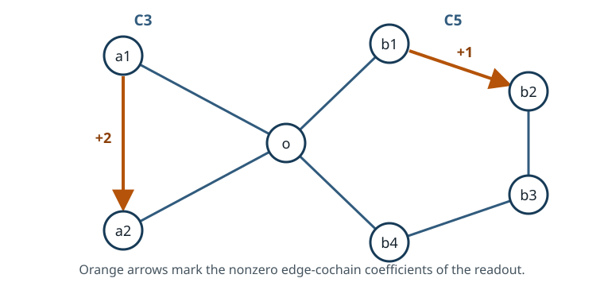

# End-to-end example: a wedge of C3 and C5

Suppose a system can circulate around two loops, but its extra counter reports
only a weighted sum of the two cycle counts. Which histories remain
indistinguishable, and does that counter reduce the sampling requirements?

Follow one counter from graph input through the integer filtration and its
sampling interpretation, then compare three observation choices in one study.
The weighted counter removes the earliest hidden direction while retaining a
parity signal at the next layer. Snapshots alone and separate counters for the
two loops provide the comparison.

## Network and readout

The graph is the wedge $C_3\vee C_5$: a triangle and a five-cycle share the
vertex `o`.



Its first Betti number is two. Let $e_3$ and $e_5$ denote the triangle and
five-cycle coordinates. The integer side readout is chosen so that

$$
\pi(e_3)=2,
\qquad
\pi(e_5)=1.
$$

Writing the history coordinates as $(n_3,n_5)$, the extra readout is
$y=2n_3+n_5$. Thus $y$ reveals the parity of $n_5$, but the two histories
$(n_3,n_5)$ and $(n_3-1,n_5+2)$ give the same value. Here the coordinates use
fixed endpoint references; for an open path the corresponding edge counter
differs only by a known endpoint correction.

In the deterministic homology basis, these values are represented by the
matrix $P=[\pi]_{\mathcal B}$. The abstract object reported in scientific
statements is the image $\pi(L_m)$; $P$ is its auditable coordinate
representation.

The complete input is
[`examples/wedge_c3_c5.json`](../examples/wedge_c3_c5.json). It requests layers
through three, a cycle budget of `100000`, and the asymptotic exponent
$\alpha=1/2$ through the field `alpha`. Although the graph-size natural horizon
is four, layer three already exposes all of $H_1(G;\mathbb Z)$, so the result is
certified `COMPLETE`.

## Analysis at a glance

| Step | Computed object | Result in this example |
| --- | --- | --- |
| Validate the network | Connected simple graph and normalized edge cochains | $C_3\vee C_5$ with one integer readout |
| Construct homology | $\Lambda=H_1(G;\mathbb Z)$ | $\Lambda\cong\mathbb Z^2$ with coordinates $e_3,e_5$ |
| Expose short cycles | $L_2$ | $\langle e_3\rangle$ |
| Expose the full graph cycle space | $L_3$ | $\langle e_3,e_5\rangle$ |
| Apply the readout | $\pi(L_m)$ and $K_m$ | Visible index-two change and one hidden free direction |
| Interpret the filtration | Graded quotients and phase data | Visible $\mathbb Z/2\mathbb Z$ at layer three; hidden layer critical at $\alpha=1/2$ |

## Run the example

Follow the [installation instructions](../README.md#install), then run the
commands below from the checkout directory. They use the environment directly.
On Windows, use `.venv\Scripts\homological-observability.exe` in place of
`.venv/bin/homological-observability`. Run Python examples with
`.venv/bin/python` (Windows: `.venv\Scripts\python.exe`). The model is included
in the package.

```console
$ .venv/bin/homological-observability example wedge-c3-c5
$ .venv/bin/homological-observability example wedge-c3-c5 --format json
```

The first command gives a compact table. The second emits a structured result
that records the software version used for this run. Reference
[JSON](../examples/wedge_c3_c5_result.json) and
[Markdown](../examples/wedge_c3_c5_result.md) reports show the same scientific
calculation; their producer version identifies the run that created them.

## Layer two: triangle exposure

Simple cycles of length at most four include the triangle but not the
five-cycle. Therefore

$$
L_2=\langle e_3\rangle,
\qquad
\pi(L_2)=2\mathbb Z,
\qquad
K_2=L_2\cap\ker\pi=0.
$$

Relative to the zero previous layer, the exposure and visible quotients each
have free rank one. The visible generator is $2$, not $1$. Retaining that
integer scale is necessary for detecting what changes at the next layer.

## Layer three: five-cycle exposure

At length bound six, the five-cycle becomes available:

$$
L_3=\langle e_3,e_5\rangle=\mathbb Z^2,
\qquad
\pi(L_3)=\langle2,1\rangle=\mathbb Z,
$$

and

$$
K_3=\langle-e_3+2e_5\rangle.
$$

The three graded quotients are

$$
\frac{L_3}{L_2}\cong\mathbb Z,
\qquad
\frac{\pi(L_3)}{\pi(L_2)}\cong\mathbb Z/2\mathbb Z,
\qquad
\frac{K_3}{K_2}\cong\mathbb Z.
$$

### Why real rank is insufficient

Both $\pi(L_2)=2\mathbb Z$ and $\pi(L_3)=\mathbb Z$ span the same
one-dimensional real vector space. A calculation that keeps only real rank
therefore reports rank one at both layers and sees no change.

The integer inclusion $2\mathbb Z\subset\mathbb Z$ has index two. Modulo the
old visible lattice, the final image has two cosets: even and odd. The quotient
$\mathbb Z/2\mathbb Z$ records the newly accessible odd class. It is a
finite-index effect in the graded visible image, not torsion in
$H_1(G;\mathbb Z)$ itself.

### Why the readout misses the hidden direction

The generator of $K_3$ combines the two cycle directions as
$-e_3+2e_5$. The readout sends it to

$$
\pi(-e_3+2e_5)=-2+2=0.
$$

Thus distinct exposed trajectory classes can differ along this integral
direction while producing the same side-readout value. This is the hidden
ambiguity that contributes to the information phase law.

## Phase interpretation

The paper assigns layer $m$ the critical exponent

$$
\alpha_m=\frac{1}{m-1}.
$$

With the requested $\alpha=1/2$:

| Layer $m$ | Hidden graded free rank $d_m$ | Scaling exponent $1-\alpha(m-1)$ | Regime |
| ---: | ---: | ---: | --- |
| 2 | 0 | $1/2$ | `DENSE` |
| 3 | 1 | $0$ | `CRITICAL` |

The triangle layer is dense, but its hidden rank is zero: the counter resolves
that direction. The surviving combination $-e_3+2e_5$ enters at layer three,
where $\lambda_3=T\delta^2$ stays of order one for this sampling request.
Its leading logarithmic entropy coefficient is

$$
\frac{d_3}{2}\max\bigl(1-\alpha(3-1),0\bigr)=0.
$$

This zero does not mean that the ambiguity vanishes. At criticality the limit
can retain nontrivial order-one uncertainty; the coefficient records only the
leading growth proportional to $\log T$.

These phase labels apply the paper's asymptotic theorem. They do not estimate a
finite-sample error probability for this graph.

## Compare observation choices

Keeping the graph fixed isolates what the counters contribute. To interpret
the sampling requirements, use the paper's benchmark: a stationary process
with a fixed, known generator, positive rates in both directions, regular
noiseless state snapshots, and the stated exact counters.

In the joint limit $T\to\infty$, $\delta\to0$, with $T/\delta$ an integer,
Corollary 6.5 gives an exact criterion for recovering the complete integer
cycle displacement. When the counters leave a hidden direction, the optimal
average success probability tends to one if and only if the exposure of the
earliest nonzero hidden layer vanishes:

| Extra readout | Earliest hidden layer | Hidden history difference | Recovery condition |
| --- | --- | --- | --- |
| None | 2 | Triangle winding already remains hidden | $T\delta\to0$ |
| $2n_3+n_5$ | 3 | $(-1,2)$ in the two cycle coordinates | $T\delta^2\to0$ |
| $n_3$ and $n_5$ separately | None | No hidden cycle direction | The exact counters determine the target on every run |

With $N_T=T/\delta$ sampling windows in normalized units, the first two
conditions are equivalently $N_T/T^2\to\infty$ and
$N_T/T^{3/2}\to\infty$. For example, under $\delta=T^{-3/4}$ the
uninstrumented triangle direction is supercritical, whereas the weighted
counter's first hidden layer is subcritical. This comparison concerns the
growth of snapshot requirements; it does not assign a cost to the counters.

Use a comparison study to run these three choices under shared conditions.
Start from the packaged model, reuse its weighted readout, and add the other
two configurations. The sampling exponent is $\alpha=3/4$ for every candidate:

```python
import homological_observability as ho

base = ho.model_to_dict(ho.load_example("wedge-c3-c5"))
weighted = base.pop("readouts")
settings = base.pop("analysis")
settings["alpha"] = 0.75

separate = [
    {"name": name, "coefficients": [{"edge": edge, "coefficient": 1}]}
    for name, edge in [
        ("triangle", ["a1", "a2"]),
        ("five-cycle", ["b1", "b2"]),
    ]
]
study = {
    "schema_version": 1,
    "name": "Wedge counter choices",
    "model": base,
    "analysis": settings,
    "configurations": [
        {"id": "none", "label": "Snapshots only", "readouts": []},
        {"id": "weighted", "label": "Weighted counter", "readouts": weighted},
        {"id": "separate", "label": "Separate counters", "readouts": separate},
    ],
}
comparison = ho.compare_configurations(study)
print(ho.render_comparison_text(comparison))
```

The first hidden layers are `2`, `3`, and `None`, respectively, in
`comparison["rows"]`. All three candidates reach the full cycle lattice.
The separate counters strictly refine the weighted counter, which strictly
refines snapshots alone: each step distinguishes all histories distinguished
before it and resolves additional ambiguity. The `relations` records contain
the exact integer certificates; `results` contains each candidate's full
filtration and phase analysis.

In the same Python session, save the result into a new directory:

```python
ho.write_comparison_bundle(comparison, "wedge-comparison")
```

The bundle contains a readable report, the shared study, and the individual
analyses. Its saved input can be run directly from the command line:

```bash
.venv/bin/homological-observability compare wedge-comparison/study.json --output-dir wedge-replay
```

The [comparison guide](COMPARISON_GUIDE.md) develops this workflow with
equivalent and incomparable counters, channel redundancy, and incomplete
computations. These cases help distinguish a gain in one sampling objective
from a gain in the information retained.

## Read it through the Python API

```python
import homological_observability as ho

model = ho.load_example("wedge-c3-c5")
result = ho.analyze_model(model)
document = ho.analysis_to_dict(
    result,
    artifact_role=ho.ArtifactRole.BUILTIN_EXAMPLE,
)

layer3 = document["filtration"]["layers"][3]
assert layer3["visible"]["graded_quotient"]["torsion_factors"] == [2]
assert layer3["hidden"]["graded_quotient"]["free_rank"] == 1
assert document["phase"]["layers"][1]["regime"] == "CRITICAL"
```

## Change the sampling request

The exact lattices do not depend on $\alpha$, observation time, or sampling
interval. To inspect finite-scale control parameters instead of asymptotic
regimes, remove `alpha` and provide both

```json
{
  "observation_time": 100.0,
  "sampling_interval": 0.1
}
```

inside the `analysis` object. The phase result then reports
$\lambda_2=10$ and $\lambda_3=1$ while leaving regime labels `null`.

## Continue with your own question

This example demonstrates staged exposure, an index-two visible inclusion, a
hidden free direction, and the phase-law translation in one small network. Its
integer statements are exact. Its phase statements are theorem-derived
asymptotic predictions.

To compare your own counters, follow the
[study-editing steps](COMPARISON_GUIDE.md#compare-your-own-configurations) and
choose the sampling request for your question. If you also need the relative
weights of competing paths at criticality, the
[biased C4 critical experiment](CRITICAL_EXPERIMENT.md) shows how to supply
exact rates and construct the limiting mark law. The
[scientific scope](SCIENTIFIC_SCOPE.md) describes the assumptions behind these
uses.
