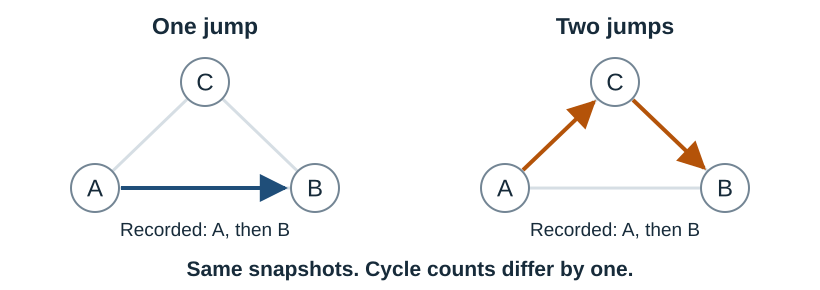

# Homological Observability

**Homological observability is the recoverability of a system's accumulated
cycle history from observations with finite temporal resolution.**

This package provides **computational tools for homological observability**,
including exact integer calculations and reproducible finite-model examples.
Use your own network to identify hidden cycle information, determine the
sampling requirements for recovery, and find which counters reveal a chosen
current. For a finite record, you can also use known transition rates to
estimate the probabilities of the target values that remain possible.

> **Paper:** Liu, H., Tian, Y., Wu, Z., & Cheng, J. (2026).
> *[Stochastic Histories at Finite Temporal Resolution: Homological Observability
> and Information Phase Diagrams in Markov Jump Processes](https://www.alphaxiv.org/abs/2610.homological-observability-markov-jump-processes)*

The recording process determines which differences between histories appear in
the data. Even with known transition rates, a detector that records only the
state at each snapshot can miss an entire turn.

For example, a system can move from A to B directly or via A → C → B between
two snapshots. Both routes produce the same endpoints, while their difference
is one circulation around the triangle. Repeated unresolved circulations
create uncertainty in the accumulated history.



Longer observation gives you more snapshots, but it also extends the history
you want to recover. How fast must the sampling interval shrink to keep up?
For stationary finite-state Markov jump processes, **the theory establishes an
information phase diagram and sharp sampling thresholds for recovering accumulated
cycle histories.** It describes how uncertainty grows, derives the conditional
laws at critical sampling scales and counts independent hidden cycle directions
at each scale. These transitions persist at equilibrium. Under detailed balance,
forward and reverse circulations cancel on average, while the winding of an
individual trajectory can remain uncertain.

## Research tasks

- [Analyze your own network](https://github.com/yeruciwenrou-dotcom/homological-observability/blob/8421229a99729b81d2d5624a92eeeb00d23d46e8/README.md#analyze-your-own-network) to find hidden cycle differences, the order at which they appear and the sampling requirements for recovering the history.
- [Recover a chosen target](https://github.com/yeruciwenrou-dotcom/homological-observability/blob/8421229a99729b81d2d5624a92eeeb00d23d46e8/docs/TARGET_TASKS.md) to test whether endpoints and counters fix its value and which extra channels would suffice. If several values fit one measurement, [infer their probabilities](https://github.com/yeruciwenrou-dotcom/homological-observability/blob/8421229a99729b81d2d5624a92eeeb00d23d46e8/docs/FINITE_RECORDS.md#use-your-own-model).
- [Compare counter configurations](https://github.com/yeruciwenrou-dotcom/homological-observability/blob/8421229a99729b81d2d5624a92eeeb00d23d46e8/docs/COMPARISON_GUIDE.md) to see which reveal different or redundant information. With complete or simulated event paths, [compare schedules and counters](https://github.com/yeruciwenrou-dotcom/homological-observability/blob/8421229a99729b81d2d5624a92eeeb00d23d46e8/docs/FINITE_RECORDS.md#compare-recording-protocols) by their error and recording requirements.
- [Evaluate scientific ML predictions](https://github.com/yeruciwenrou-dotcom/homological-observability/blob/8421229a99729b81d2d5624a92eeeb00d23d46e8/docs/SCIENTIFIC_ML.md) on paired observations, with exact reconstruction and simple predictors as baselines.
- [Run finite-model experiments](https://github.com/yeruciwenrou-dotcom/homological-observability/blob/8421229a99729b81d2d5624a92eeeb00d23d46e8/README.md#reproduce-the-paper-evidence) to reproduce the paper's numerical results. Supply a graph and directed rates to [construct a critical experiment](https://github.com/yeruciwenrou-dotcom/homological-observability/blob/8421229a99729b81d2d5624a92eeeb00d23d46e8/docs/CRITICAL_EXPERIMENT.md).

The graph must be finite, connected, and simple, with positive transition-rate
support in both directions. The recording protocol uses regular noiseless
state snapshots and optional exact counters. Network and counter structure
can be analyzed from the graph alone. Finite-record probabilities use the
supplied rates. The
[critical experiment](https://github.com/yeruciwenrou-dotcom/homological-observability/blob/8421229a99729b81d2d5624a92eeeb00d23d46e8/docs/CRITICAL_EXPERIMENT.md) uses exact positive rates to
compute path weights and limiting mark distributions.

## Install

Use Python 3.11–3.13. In an activated virtual environment, install the
2.2 development branch and check its version.

```sh
python -m pip install "https://github.com/yeruciwenrou-dotcom/homological-observability/archive/refs/heads/upgrade/finite-time-observability.zip"
homological-observability --version
```

This branch reports `2.2.0.dev0`. For the published 2.1.0 distribution,
use `python -m pip install homological-observability==2.1.0` and follow its
[versioned guide](https://github.com/yeruciwenrou-dotcom/homological-observability/blob/v2.1.0/README.md#install). Earlier results have their
[2.0.0 reproduction guide](https://github.com/yeruciwenrou-dotcom/homological-observability/blob/v2.0.0/README.md) and an
[input and output format guide](https://github.com/yeruciwenrou-dotcom/homological-observability/blob/8421229a99729b81d2d5624a92eeeb00d23d46e8/docs/OUTPUT_CONTRACT.md#reading-earlier-records).

## Try a finite record

In a flashing ratchet, `DeltaW` is the difference between the signed turns
made while the potential is ON and OFF. A total-turn counter records their
sum. Try both the single record and the paired study.

```sh
homological-observability posterior --example dfr --output-dir ratchet-record
homological-observability compare-protocols --example dfr --output-dir ratchet-study
```

For this record, `ratchet-record/report.txt` shows that only even values of
`DeltaW` are possible and that zero has probability 99.63%. In
`ratchet-study/report.txt`, all three recording protocols use the same
64 simulated paths and eight snapshots per path. The mean conditional
probability of a wrong best guess is 39.95% with snapshots alone, 15.42%
after adding total turns, and zero after also recording ON turns.
Together the two counters determine the difference exactly. The first
probability refers to one observed record. The three risks compare choices
for a whole collection.

For your own system, start with
`homological-observability posterior --example triangle --output-dir my-ring`.
Edit `my-ring/request.json` to supply your labeled states, rates and measurements,
then run `homological-observability posterior my-ring/request.json`.
The [finite-record guide](https://github.com/yeruciwenrou-dotcom/homological-observability/blob/8421229a99729b81d2d5624a92eeeb00d23d46e8/docs/FINITE_RECORDS.md) also gives a Python
example and explains the numerical precision reported with each result. A
[molecular-motor example](https://github.com/yeruciwenrou-dotcom/homological-observability/blob/8421229a99729b81d2d5624a92eeeb00d23d46e8/docs/FINITE_RECORDS.md#a-mechanical-and-chemical-target)
uses mechanical and chemical counts to infer net ATP hydrolysis in a six-state
kinesin model.

## Try target diagnosis and observation design

The discrete flashing ratchet example asks whether total circulation W determines
the difference DeltaW between ON and OFF circulation. Its
[model and parameter sources](https://github.com/yeruciwenrou-dotcom/homological-observability/blob/8421229a99729b81d2d5624a92eeeb00d23d46e8/docs/SCIENTIFIC_ML.md#model-and-data-provenance)
are documented in the scientific ML guide. Run the bundled CPU case:

```bash
python -m homological_observability.applications.dfr run --output-dir dfr-case
```

Read `dfr-case/report.txt`:

- Snapshots and W leave DeltaW unresolved.
- Adding W_ON or W_OFF determines DeltaW; one added scalar channel is the
  minimum within the supplied candidate pool.
- The sufficient schemes evaluated in the case reconstruct all 64 bundled
  trajectories exactly.
- Natural-test prediction scores and the separate constructed ambiguity-pair
  scores have their own sample counts and baselines.

The diagnosis helps choose between adding a counter to future collection,
replaying complete event logs, or adapting the prediction target and evaluation
to the available records.

The [scientific ML tutorial](https://github.com/yeruciwenrou-dotcom/homological-observability/blob/8421229a99729b81d2d5624a92eeeb00d23d46e8/docs/SCIENTIFIC_ML.md) explains the model's
sources, paired observation schemes and prediction interface. Users can train
models separately and submit point predictions for evaluation. The supplied
predictor is a training-median baseline.

Use the [target guide](https://github.com/yeruciwenrou-dotcom/homological-observability/blob/8421229a99729b81d2d5624a92eeeb00d23d46e8/docs/TARGET_TASKS.md) to define your own graph,
fixed counters, targets and candidate channels. Saved requests, results and
reports support inspection and replay.

## Try a counter comparison

A four-state ring and a seven-state ring are connected by a bridge. You can
count signed crossings on either ring: which choice postpones the earliest
remaining cycle-history ambiguity?

```bash
homological-observability study-example bridge --output bridge-study.json
homological-observability compare bridge-study.json --output-dir bridge-results
```

Open `bridge-results/comparison.md`. The study completes all six candidates;
three of its results are:

| Configuration | First hidden layer | Remaining hidden rank |
| --- | ---: | ---: |
| Snapshots only | 2 | 2 |
| Counter x on the four-state ring | 4 | 1 |
| Counter y on the seven-state ring | 2 | 1 |

Counting the short ring postpones the first unresolved cycle direction to
layer four. Counting the long ring leaves the earlier ambiguity in place.
The two counters retain different information, even though each leaves one
hidden direction. The study also shows that a weighted counter can tie a
scalar objective without retaining the same information, and that a
proportional extra channel is redundant.

The [worked comparison](https://github.com/yeruciwenrou-dotcom/homological-observability/blob/8421229a99729b81d2d5624a92eeeb00d23d46e8/docs/COMPARISON_GUIDE.md)
explains the hidden layers and the example's sampling law. `COMPLETE` records
the scope of the calculation; the report describes the remaining ambiguity.
The bundle contains structured results, exact witnesses, the input, and replay
instructions. Each run uses a new output directory.

## Reproduce the paper evidence

After installing the package above, run:

```bash
homological-observability reproduce --check --output-dir generated_results
```

This command regenerates the paper's finite-model calculations, compares them
with the packaged reference data, and writes `generated_results/REPORT.md`
and `generated_results/companion_summary.png`. Successful verification prints
`PASS: all calculation checks completed` and
`PASS: generated tables agree with frozen reference results`.
The output directory also contains the numerical CSV tables.
For pinned dependencies
and the reader-side test suite, follow the
[reproduction guide](https://github.com/yeruciwenrou-dotcom/homological-observability/blob/8421229a99729b81d2d5624a92eeeb00d23d46e8/README.md#full-verification-from-source).

## Analyze your own network

For one observation scheme, prepare `my-model.json` with your graph, optional
counter rules, and any sampling parameters. The
[model input guide](https://github.com/yeruciwenrou-dotcom/homological-observability/blob/8421229a99729b81d2d5624a92eeeb00d23d46e8/docs/MODEL_GUIDE.md)
explains the fields and includes a complete example. Run:

```bash
homological-observability analyze my-model.json
```

To compare several counter configurations, adapt the bridge study.
Save a copy of `bridge-study.json` as `my-study.json`. Update the study and
model names, research question, graph, and candidate counters. Replace the
example's `alpha: 0.375` with your own sampling exponent, or remove it for a
comparison of graph and counter information alone. Keep an explicit cycle
enumeration budget, then run:

```bash
homological-observability compare my-study.json --output-dir my-results
```

The [study editing guide](https://github.com/yeruciwenrou-dotcom/homological-observability/blob/8421229a99729b81d2d5624a92eeeb00d23d46e8/docs/COMPARISON_GUIDE.md#compare-your-own-configurations)
walks through these choices. The [input guide](https://github.com/yeruciwenrou-dotcom/homological-observability/blob/8421229a99729b81d2d5624a92eeeb00d23d46e8/docs/MODEL_GUIDE.md)
describes signed edge increments, sampling units, validation, and resource
limits. For dense graphs, `--backend generators` computes the integer layers
from shortest-path cycle generators. On the complete eight-vertex graph,
56 generators recover the layers obtained from all 8,018 simple cycles.
The [integer backend guide](https://github.com/yeruciwenrou-dotcom/homological-observability/blob/8421229a99729b81d2d5624a92eeeb00d23d46e8/docs/CONVENTIONS.md#shortest-path-generators)
explains the output and work budgets. Each exported study also includes a
model file for every candidate.

## Exact sampling requests

Model and study format 2 accept `"alpha": "1/3"`.
This gives an exactly critical fourth layer. A JSON number such as
`0.3333333333333333` keeps its binary floating-point value and gives a slightly
positive exponent at that layer. Use the fraction when your intended law is
exactly one third. Phase classification uses the exact value supplied.

Reports follow the request: structure alone shows hidden information and
counter relations; an exponent adds phases and entropy contributions; a
finite observation time and interval add exposure scales with each hidden
graded quotient. Each result states which layers were computed.

## Python API

Run this with the virtual environment's Python interpreter:

```python
import homological_observability as ho

study = ho.load_study_example("bridge")
comparison = ho.compare_configurations(study)
print(ho.render_comparison_text(comparison))
```

Use `ho.load_study("my-study.json")` for your own study. The
[output guide](https://github.com/yeruciwenrou-dotcom/homological-observability/blob/8421229a99729b81d2d5624a92eeeb00d23d46e8/docs/OUTPUT_CONTRACT.md)
describes structured results and renderers for single-configuration analysis
and rate-dependent critical experiments. Use `ho.infer_target_posterior(request)`
for a finite record and `ho.compare_recording_protocols(request)` for a paired
study. Both take the same dictionaries described in the
[finite-record guide](https://github.com/yeruciwenrou-dotcom/homological-observability/blob/8421229a99729b81d2d5624a92eeeb00d23d46e8/docs/FINITE_RECORDS.md).

## Interpretation and further reading

Integer lattice calculations and finite catalogues are exact when complete.
Sampling thresholds, phase labels, and entropy coefficients describe long-time
asymptotic limits under the stated model assumptions. For an individual record
the software first determines which target values are compatible with its
endpoints and counters. Numerical probabilities for one scalar target are
supported at effective joint integer rank one or two. A paired study reports
how the conditional error changes with the recording protocol. Its report
also identifies unresolved records and the resources used by each protocol.

- [Overview and first study](https://github.com/yeruciwenrou-dotcom/homological-observability/blob/8421229a99729b81d2d5624a92eeeb00d23d46e8/README.md)
- [Scientific assumptions and research uses](https://github.com/yeruciwenrou-dotcom/homological-observability/blob/8421229a99729b81d2d5624a92eeeb00d23d46e8/docs/SCIENTIFIC_SCOPE.md)
- [Integer layers and sampling: a worked two-loop example](https://github.com/yeruciwenrou-dotcom/homological-observability/blob/8421229a99729b81d2d5624a92eeeb00d23d46e8/docs/END_TO_END_EXAMPLE.md)
- [Rate-dependent critical experiments](https://github.com/yeruciwenrou-dotcom/homological-observability/blob/8421229a99729b81d2d5624a92eeeb00d23d46e8/docs/CRITICAL_EXPERIMENT.md)
- [Changes by version](https://github.com/yeruciwenrou-dotcom/homological-observability/blob/8421229a99729b81d2d5624a92eeeb00d23d46e8/CHANGELOG.md)
- [Report an issue](https://github.com/yeruciwenrou-dotcom/homological-observability/issues)

## Theory and citation

The [paper map](https://github.com/yeruciwenrou-dotcom/homological-observability/blob/8421229a99729b81d2d5624a92eeeb00d23d46e8/PAPER_MAP.md)
connects the software's calculations to the theoretical results and paper evidence.

Cite the paper for theoretical results and the software for computations.
When your work uses both, cite them separately. The
[citation guide](https://github.com/yeruciwenrou-dotcom/homological-observability/blob/8421229a99729b81d2d5624a92eeeb00d23d46e8/README.md#citation-and-license)
provides the full paper and software references and a copyable paper BibTeX entry.
For results obtained from a development branch, record the Git commit used
and cite the [software series DOI](https://doi.org/10.5281/zenodo.23329442).
The published [2.1.0 release](https://github.com/yeruciwenrou-dotcom/homological-observability/releases/tag/v2.1.0)
has its own [archived version DOI](https://doi.org/10.5281/zenodo.24058140).

Authors: HongZheng Liu, YiNuo Tian, Zhiyue Wu, and Jianqun Cheng.

The software is distributed under the MIT License. The archived paper is
licensed under [CC BY 4.0](https://creativecommons.org/licenses/by/4.0/).
