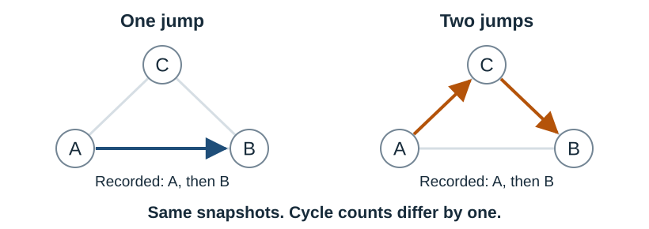

# Homological Observability

This repository provides **computational tools for homological observability**,
including exact integer calculations and reproducible finite-model examples.
Apply it to your own network to identify hidden cycle information and determine
the sampling requirements for recovering it.

> **Paper:** Liu, H., Tian, Y., Wu, Z., & Cheng, J. (2026).
> *[Stochastic Histories at Finite Temporal Resolution: Homological Observability
> and Information Phase Diagrams in Markov Jump Processes](https://www.alphaxiv.org/abs/2610.homological-observability-markov-jump-processes)*

**Homological observability is the recoverability of a system's accumulated
cycle history from observations with finite temporal resolution.** Its physical
origin is finite access to motion: whenever dynamically allowed trajectories
with different net circulations produce the same record, that record
necessarily leaves part of the cycle history unresolved.

For example, a system can move from A to B directly or via A → C → B between
two snapshots. Both routes produce the same endpoints, while their difference
is one circulation around the triangle. Repeated unresolved circulations
create uncertainty in the accumulated history.



For finite-state Markov jump processes, **we establish an information phase
diagram and sharp sampling thresholds for recovering accumulated cycle
histories.** The theory quantifies how uncertainty grows with observation time
and resolution, derives the posterior laws at critical sampling scales, and
determines the number of independent hidden cycle directions at each scale
from the phase diagram. These information transitions persist at equilibrium
under detailed balance.

[Reproduce the calculations](https://github.com/yeruciwenrou-dotcom/homological-observability/blob/feat/target-observability/README.md#reproduce-the-paper-evidence) ·
[Cite](https://github.com/yeruciwenrou-dotcom/homological-observability/blob/feat/target-observability/README.md#citation-and-license)

You can use the software to:

- **[Analyze your own network](https://github.com/yeruciwenrou-dotcom/homological-observability/blob/feat/target-observability/README.md#analyze-your-own-network):** provide a transition graph and
  optional integer counter rules to identify hidden cycle differences and
  asymptotic sampling requirements.
- **[Diagnose and design for a target](https://github.com/yeruciwenrou-dotcom/homological-observability/blob/feat/target-observability/docs/TARGET_TASKS.md):** determine whether fixed
  counters and known endpoints suffice, find the minimum extra channels within
  a specified pool, and recover targets from legal records.
- **[Evaluate model predictions](https://github.com/yeruciwenrou-dotcom/homological-observability/blob/feat/target-observability/docs/SCIENTIFIC_ML.md):** compare predictions
  against exact reconstruction and simple baselines on paired observations.
- **[Compare counter configurations](https://github.com/yeruciwenrou-dotcom/homological-observability/blob/feat/target-observability/README.md#compare-counter-configurations):** determine which choices
  reveal different or redundant information, with explanatory reports and
  exact integer evidence.
- **[Construct a critical experiment](https://github.com/yeruciwenrou-dotcom/homological-observability/blob/feat/target-observability/docs/CRITICAL_EXPERIMENT.md):** use known transition rates to calculate
  critical path weights, conditional mark laws and Poisson intensities.
- **[Reproduce the paper](https://github.com/yeruciwenrou-dotcom/homological-observability/blob/feat/target-observability/README.md#reproduce-the-paper-evidence):** regenerate the included finite-model
  calculations and compare them with the reference results.

The graph must be finite, connected, and simple, with positive transition-rate
support in both directions. The recording protocol uses regular noiseless
state snapshots and optional exact counters. **Network and counter analyses
need no rate values.** The
[critical experiment](https://github.com/yeruciwenrou-dotcom/homological-observability/blob/feat/target-observability/docs/CRITICAL_EXPERIMENT.md) uses exact positive rates to
compute path weights and limiting mark distributions.

## Install

Version: **2.1.0.dev0**.

Use Python 3.11–3.13. Clone the repository and install it in a virtual
environment. On macOS or Linux:

```bash
git clone --branch feat/target-observability https://github.com/yeruciwenrou-dotcom/homological-observability.git
cd homological-observability
python3 -m venv .venv
.venv/bin/python -m pip install -e .
```

If you already have this checkout, start with the virtual-environment step
from its root directory.

On Windows PowerShell:

```powershell
git clone --branch feat/target-observability https://github.com/yeruciwenrou-dotcom/homological-observability.git
cd homological-observability
py -3.12 -m venv .venv
.venv\Scripts\python.exe -m pip install -e .
```

Python 3.11 or 3.13 can be selected in place of 3.12.

These commands use the virtual environment directly, so activation is optional.
Installation needs internet access; examples and reference data are included
in the package. Run the commands below from the repository directory.
In the linked guides, use
`.venv\Scripts\homological-observability.exe` in place of
`.venv/bin/homological-observability` on Windows, and
`.venv\Scripts\python.exe` in place of `.venv/bin/python`.

Upgrading from 2.0.0 preserves the existing network-analysis, comparison,
critical-experiment and paper-reproduction workflows, along with their input
and result formats. Target tasks add separate request and result formats;
see the [changelog](https://github.com/yeruciwenrou-dotcom/homological-observability/blob/feat/target-observability/CHANGELOG.md) for the new capabilities.

To reproduce work with version 2.0.0, install `homological-observability==2.0.0` in a
separate environment and follow its
[versioned guide](https://github.com/yeruciwenrou-dotcom/homological-observability/blob/v2.0.0/README.md).
For upgrades from 1.x, see the
[format and API changes](https://github.com/yeruciwenrou-dotcom/homological-observability/blob/feat/target-observability/docs/OUTPUT_CONTRACT.md#reading-earlier-records).

## Try target diagnosis and observation design

The discrete flashing ratchet example asks whether total circulation W determines
the difference DeltaW between ON and OFF circulation. Its
[model and parameter sources](https://github.com/yeruciwenrou-dotcom/homological-observability/blob/feat/target-observability/docs/SCIENTIFIC_ML.md#model-and-data-provenance)
are documented in the scientific ML guide. Run the bundled CPU case:

```bash
.venv/bin/python -m homological_observability.applications.dfr run --output-dir dfr-case
```

Read `dfr-case/report.txt`:

- Snapshots and W leave DeltaW unresolved.
- Adding W_ON or W_OFF determines DeltaW; one added scalar channel is the
  minimum within the supplied candidate pool.
- The sufficient schemes evaluated in the case reconstruct all 64 bundled
  trajectories exactly.
- Natural-test prediction scores and the separate constructed ambiguity-pair
  scores have their own sample counts and baselines.

The diagnosis helps choose between adding a counter to future collection,
replaying complete event logs, or adapting the prediction target and evaluation
to the available records.

The [scientific ML tutorial](https://github.com/yeruciwenrou-dotcom/homological-observability/blob/feat/target-observability/docs/SCIENTIFIC_ML.md) explains the model's
sources, paired observation schemes and prediction interface. Users can train
models separately and submit point predictions for evaluation. The supplied
predictor is a training-median baseline.

Use the [target guide](https://github.com/yeruciwenrou-dotcom/homological-observability/blob/feat/target-observability/docs/TARGET_TASKS.md) to define your own graph,
fixed counters, targets and candidate channels. Saved requests, results and
reports support inspection and replay.

## Try a counter comparison

A four-state ring and a seven-state ring are connected by a bridge. You can
count signed crossings on either ring: which choice postpones the earliest
remaining cycle-history ambiguity?

```bash
.venv/bin/homological-observability study-example bridge --output bridge-study.json
.venv/bin/homological-observability compare bridge-study.json --output-dir bridge-results
```

Open `bridge-results/comparison.md`. The study completes all six candidates;
three of its results are:

| Configuration | First hidden layer | Remaining hidden rank |
| --- | ---: | ---: |
| Snapshots only | 2 | 2 |
| Counter x on the four-state ring | 4 | 1 |
| Counter y on the seven-state ring | 2 | 1 |

Counting the short ring postpones the first unresolved cycle direction to
layer four. Counting the long ring leaves the earlier ambiguity in place.
The two counters retain different information, even though each leaves one
hidden direction. The study also shows that a weighted counter can tie a
scalar objective without retaining the same information, and that a
proportional extra channel is redundant.

The [worked comparison](https://github.com/yeruciwenrou-dotcom/homological-observability/blob/feat/target-observability/docs/COMPARISON_GUIDE.md)
explains the hidden layers and the example's sampling law. `COMPLETE` records
the scope of the calculation; the report describes the remaining ambiguity.
The bundle contains structured results, exact witnesses, the input, and replay
instructions. Each run uses a new output directory.

## Reproduce the paper evidence

After installing the package above, run:

```bash
.venv/bin/homological-observability reproduce --check --output-dir generated_results
```

This command regenerates the paper's finite-model calculations, compares them
with the packaged reference data, and writes `generated_results/REPORT.md`
and `generated_results/companion_summary.png`. Successful verification prints
`PASS: all calculation checks completed` and
`PASS: generated tables agree with frozen reference results`.
The output directory also contains the numerical CSV tables.
For pinned dependencies
and the reader-side test suite, follow the
[reproduction guide](https://github.com/yeruciwenrou-dotcom/homological-observability/blob/feat/target-observability/README.md#full-verification-from-source).

## Analyze your own network

For one observation scheme, prepare `my-model.json` with your graph, optional
counter rules, and any sampling parameters. The
[model input guide](https://github.com/yeruciwenrou-dotcom/homological-observability/blob/feat/target-observability/docs/MODEL_GUIDE.md)
explains the fields and includes a complete example. Run:

```bash
.venv/bin/homological-observability analyze my-model.json
```

To compare several counter configurations, adapt the bridge study.
Save a copy of `bridge-study.json` as `my-study.json`. Update the study and
model names, research question, graph, and candidate counters. Replace the
example's `alpha: 0.375` with your own sampling exponent, or remove it for a
comparison of graph and counter information alone. Keep an explicit cycle
enumeration budget, then run:

```bash
.venv/bin/homological-observability compare my-study.json --output-dir my-results
```

The [study editing guide](https://github.com/yeruciwenrou-dotcom/homological-observability/blob/feat/target-observability/docs/COMPARISON_GUIDE.md#compare-your-own-configurations)
walks through these choices. The [input guide](https://github.com/yeruciwenrou-dotcom/homological-observability/blob/feat/target-observability/docs/MODEL_GUIDE.md)
describes signed edge increments, sampling units, validation, and resource
limits. Every exported study also includes a model file for each candidate,
ready to inspect separately with `analyze`.

## Exact sampling requests

Model and study format 2 accept `"alpha": "1/3"`.
This gives an exactly critical fourth layer. A JSON number such as
`0.3333333333333333` keeps its binary floating-point value and gives a slightly
positive exponent at that layer. Use the fraction when your intended law is
exactly one third. Phase classification uses the exact value supplied.

Reports follow the request: structure alone shows hidden information and
counter relations; an exponent adds phases and entropy contributions; a
finite observation time and interval add exposure scales with each hidden
graded quotient. Each result states which layers were computed.

## Python API

Run this with the virtual environment's Python interpreter:

```python
import homological_observability as ho

study = ho.load_study_example("bridge")
comparison = ho.compare_configurations(study)
print(ho.render_comparison_text(comparison))
```

Use `ho.load_study("my-study.json")` for your own study. The
[output guide](https://github.com/yeruciwenrou-dotcom/homological-observability/blob/feat/target-observability/docs/OUTPUT_CONTRACT.md)
describes structured results and renderers, including single-configuration
analysis and rate-dependent critical experiments.

## Interpretation and further reading

Integer lattice calculations and finite catalogues are exact when complete.
Sampling thresholds, phase labels, and entropy coefficients describe long-time
asymptotic limits under the stated model assumptions. Choosing a sampling
interval for a specified finite-run error tolerance requires additional risk
analysis. Cycle enumeration can grow exponentially; use computation budgets
and check the reported completeness of each result.

- [Overview and first study](https://github.com/yeruciwenrou-dotcom/homological-observability/blob/feat/target-observability/README.md)
- [Scientific assumptions and research uses](https://github.com/yeruciwenrou-dotcom/homological-observability/blob/feat/target-observability/docs/SCIENTIFIC_SCOPE.md)
- [Integer layers and sampling: a worked two-loop example](https://github.com/yeruciwenrou-dotcom/homological-observability/blob/feat/target-observability/docs/END_TO_END_EXAMPLE.md)
- [Rate-dependent critical experiments](https://github.com/yeruciwenrou-dotcom/homological-observability/blob/feat/target-observability/docs/CRITICAL_EXPERIMENT.md)
- [Changes by version](https://github.com/yeruciwenrou-dotcom/homological-observability/blob/feat/target-observability/CHANGELOG.md)
- [Report an issue](https://github.com/yeruciwenrou-dotcom/homological-observability/issues)

## Theory and citation

The [paper map](https://github.com/yeruciwenrou-dotcom/homological-observability/blob/feat/target-observability/PAPER_MAP.md)
connects the software's calculations to the theoretical results and paper evidence.

Cite the paper for theoretical results and the software for computations.
When your work uses both, cite them separately. The
[citation guide](https://github.com/yeruciwenrou-dotcom/homological-observability/blob/feat/target-observability/README.md#citation-and-license)
provides the full paper and software references and a copyable paper BibTeX entry.
The published 2.0.0 software archive is
[doi:10.5281/zenodo.23618828](https://doi.org/10.5281/zenodo.23618828).
When using this checkout, record `2.1.0.dev0` and the exact Git commit alongside
the software citation.

Authors: HongZheng Liu, YiNuo Tian, Zhiyue Wu, and Jianqun Cheng.

The software is distributed under the MIT License. The archived paper is
licensed under [CC BY 4.0](https://creativecommons.org/licenses/by/4.0/).
