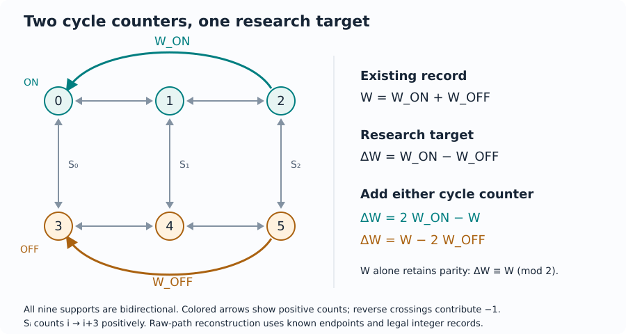

# Target diagnosis and readout design

Audit whether existing records determine a research target, find the minimum
additional scalar channels, and reconstruct targets from individual records.
Requests and results can be saved for replay. Optional explanations connect
target ambiguity to exposure layers; the
[Scientific ML tutorial](SCIENTIFIC_ML.md) applies these tools to paired data
and model predictions.

Follow the [installation instructions](../README.md#install) to run the examples.

## First task: an existing record and a new research target

The discrete flashing ratchet (DFR) support has two triangles (0,1,2) and (3,4,5), connected by the
three edges i→i+3. W_ON counts 2→0, W_OFF counts 5→3, and W=W_ON+W_OFF.
The new target is DeltaW=W_ON−W_OFF. Reverse traversals contribute minus one.
These cochains retain their physical meaning independently of the chosen
spanning tree. The cycle rank is four.
See the [model and data provenance](SCIENTIFIC_ML.md#model-and-data-provenance)
for the physical model, parameters and references.



The colored arrows set the positive signs of the two cycle counters. The
switching counters record crossings between ON and OFF states. With W fixed,
the two minimum choices for DeltaW are W_ON and W_OFF, as the search below shows.

Run from the repository directory, using the installed environment's command:

```bash
.venv/bin/homological-observability target examples/dfr_target.json
.venv/bin/homological-observability design examples/dfr_design.json --output-dir dfr-design
.venv/bin/homological-observability target examples/dfr_evaluate.json --format json
.venv/bin/homological-observability design dfr-design/request.json --format json
```

On Windows, replace `.venv/bin/homological-observability` with
`.venv\Scripts\homological-observability.exe`.

Expected conclusions:

| Input | Established result |
| --- | --- |
| Fixed W; target DeltaW | Insufficient; an integer closed chain preserves W and changes DeltaW by 2 |
| Fixed W; pool W_ON, W_OFF, S0, S1, S2 | Minimum one additional channel; exactly two ties: W_ON or W_OFF |
| W=0, W_ON=1; endpoints 0→3 | DeltaW=2 |

To design from scratch, copy `examples/dfr_design.json`, move the W entry
from `model.readouts` into `candidates`, and set `model.readouts` to `[]`.
Running `design` on that request gives a minimum of two channels, with three
tied choices: (W, W_ON), (W, W_OFF), and (W_ON, W_OFF).

The two reconstruction formulas are DeltaW=2W_ON−W and DeltaW=W−2W_OFF.
Even the insufficient W-only record retains parity: DeltaW≡W (mod 2).
For a single observation interval the paths `[0,3]` and
`[0,1,2,0,3,5,4,3,0,3]` share endpoints and W=0, but have targets 0 and 2.
The pair exhibits the ambiguity algebraically. The [ML tutorial](SCIENTIFIC_ML.md)
places all its jumps before the first positive snapshot time, giving equal
inputs across the full grid, and evaluates the two paths with equal weights.

Existing records can be audited with `target`. Additional channels apply to
future collection or replay from available complete event logs. When a simulator
already exposes every event, directly accumulating DeltaW is a valid baseline;
the design task is useful when records are fixed, restricted or shared by targets.

The original counter-comparison task also explains why individual counters
carry different information. Let C_ON be the cycle 0→1→2→0 and C_OFF the cycle
3→4→5→3. Their (W, W_ON, W_OFF) values are (1,1,0) and (1,0,1).

| Compared counters | Invisible to the first, visible to the second | Invisible to the second, visible to the first |
| --- | --- | --- |
| W_ON and W_OFF | C_OFF | C_ON |
| W and W_ON | C_ON − C_OFF | C_OFF |

These are two incomparable pairs on the full cycle group. Connecting the loops
by a switching edge traversed in opposite directions realizes their signed difference
as a closed walk without changing the counter values. Once W is fixed, adding
either cycle counter determines both and gives the same information for DeltaW.

## Use your own target

Copy `examples/dfr_design.json` and edit the following fields. The same
[graph and signed-edge conventions](MODEL_GUIDE.md#from-a-physical-model-to-an-input)
apply to fixed readouts, targets and candidates.

1. Set `model.name`, `model.vertices` and `model.edges` to describe your system.
2. Put the counters already available in `model.readouts`. Use `[]` when
   designing from scratch; place removable channels in `candidates`.
3. Define the quantities you want to recover in `targets`. Several targets
   are handled jointly, so a channel can serve more than one target.
4. List admissible additional scalar counters in `candidates`, each with a
   distinct name. The objective is the number of added channels from this pool.
   Include a direct target counter if your recording system permits it.
5. Run `design` on the saved request. For diagnosis alone, set `operation` to
   `analyze`, remove `candidates`, and run `target`.

You can also define a model directly in Python. This triangle example asks
whether a counter that adds two per crossing can determine the unit count:

```python
import homological_observability as ho

target = ho.IntegerReadout.from_mapping("count", {("c", "a"): 1})
model = ho.GraphModel.create(
    name="triangle counter",
    vertices=["a", "b", "c"],
    edges=[("a", "b"), ("b", "c"), ("c", "a")],
    readouts=[("twice", {("c", "a"): 2})],
)
diagnosis = ho.analyze_target(model, [target])
print(ho.render_target_text(diagnosis))
decoded = ho.evaluate_target(model, [target], {"twice": 2}, start="a", end="a")
assert decoded["result"]["target_values"] == {"count": 1}
```

For a closed path the recorded counter must be even. A value of one is rejected
as an illegal record, even though it can be divided by two numerically. Use
`write_target_bundle(diagnosis, "triangle-audit")` to save the request, result
and readable report for replay.

## Three calculation interfaces

```python
import homological_observability as ho

request = ho.load_target_request("examples/dfr_design.json")
design = ho.run_target_request(request)
assert design["result"]["minimum_added"] == 1
assert design["result"]["ties_complete"]
assert ho.run_target_request(design["request"]) == design
```

The direct signatures are:

```text
analyze_target(model, targets, *, limits=None, reverse_tree_order=False, explain=False) -> dict
design_readouts(model, targets, candidates, *, limits=None, reverse_tree_order=False, explain=False) -> dict
evaluate_target(model, targets, record, *, record_kind="raw", start=None,
                end=None, limits=None, reverse_tree_order=False) -> dict
```

`model` is a validated `GraphModel`. Its `readouts` are the fixed P0.
`targets` is a nonempty sequence of `IntegerReadout`; all targets must be
determined jointly. `candidates` is a sequence of scalar `IntegerReadout` whose
names are stable physical channel IDs. Candidate names are unique and disjoint
from fixed-readout names. Equal cochains with different IDs remain distinct
choices. A direct measurement of the target is an admissible candidate.
To prune removable channels, put them in the candidate pool with an empty or
smaller fixed P0; fixed channels are never silently removed.

`record` maps every fixed-readout name to exactly one integer. Booleans, unknown
keys, missing values and floats are rejected. `record_kind="raw"` requires valid
`start` and `end` vertices. The deterministic tree path is subtracted from each
readout, the cycle contribution is decoded, and the target's tree-path term is
added back. Pure-gradient targets are therefore supported. `record_kind="cycle"`
accepts already corrected records without endpoint arguments and returns the
cycle target in the selected tree convention.

Input validation rejects targets/candidates on unknown edges before algebra.
The core calculations use fundamental-cycle coordinates. Optional
`explain=True` on analyze/design adds a separately bounded exposure explanation
after the core result; `max_cycles` and `max_layer` apply to that explanation
without discarding a target certificate.

## Exactness and guarantees

Write H=Z^b for full fundamental-cycle coordinates, P for fixed readouts and F
for targets. Sufficiency is ker_Z P ⊆ ker_Z F, equivalently
rank_Q P=rank_Q [P;F]. A sufficient certificate records a rational matrix D with
DP=F, valid on the integer image P(H). An insufficient certificate records an
integer cycle z, its oriented edge chain, and Fz≠0 with Pz=0.

Decoding checks every integer-image constraint using a verified Smith
decomposition. P(x)=2x, F(x)=x permits decoding x=p/2 only for even p.
P=2I2, F=(1,1), p=(1,1)
is illegal even though the rational formula gives the integer 1. P(x)=(2x,4x),
p=(2,5) is inconsistent and is also rejected. Illegal records yield
`legal_record=false`, `target_values=null`; insufficient legal records also yield
no target value. In both cases, the completed diagnosis reports the record's
legality and the readout's sufficiency separately.

For legal p, any integer preimage c0 gives the target ambiguity set
F(c0)+F(ker_Z P). The exact ambiguity image requires a saturated integer kernel;
clearing denominators of rational-nullspace columns separately can miss lattice
points. For P=(2,1,1), F=(0,1,0), the true image is Z, not 2Z. The result format
provides ambiguity witnesses and target-image layers. The DFR example illustrates the retained parity.
Target-image exposure layers and their entropy interpretation are available
with `explain=True`. The [technical source](TARGET_THEORY.md) derives them using
the original paper's assumptions separately from this algebra.

Design first checks P0 and the entire pool, then searches increasing subset
cardinality. Exhausting smaller sizes and finding one solution proves the
minimum. Exhausting that entire size establishes tie enumeration. The result
separately records `feasible`, `minimum_proven`, `enumeration_complete`,
`ties_complete`, `certificates_complete` (for returned choices), and
`output_truncated`. Fixed, added and total channel counts are separate;
`lower_bound_added` / `upper_bound_added` retain established bounds when a
search stops before its minimum is found. `ties_found` is a count of discovered ties; it is the full
count only if enumeration completed. `fully_searched_through` counts exhaustive
cardinality levels, with -1 meaning none. A failed full-pool precheck proves
infeasibility by monotonicity and leaves this enumeration count at -1.

`TargetLimits` defaults to 10,000 subset checks,
100 returned choices, 100,000 entries per bounded matrix, 4,096 bits per checked
integer numerator/denominator, 10,000 explanation cycles, and a 30-second
cooperative deadline shared by the core and optional explanation. Prechecks,
search, legal-image solving, certificates and serialization have checkpoints.
The deadline is checked between exact operations, so a single SymPy operation
can run past it. Intermediate algebraic growth is checked at those same
boundaries. Use an externally timed process when a hard deadline is required. The [resource measurements](TARGET_VALIDATION.md#scale-and-budgets)
document tested input families and timing conditions. Exhausting a result cap preserves an
already proved minimum and complete enumeration count; it marks returned ties
incomplete. Exhausting certificate work preserves an already established rank
decision. The stop stage/resource is reported as `limit`.

## JSON and replay

The independent request and result schemas are both v1:
`load_target_request_schema()` and `load_target_task_schema()`. Existing schemas
retain their versions and semantics. Requests contain `schema_version`,
`operation` (`analyze`, `design`, `evaluate`), `model`, `targets`, and optional
`candidates`, `limits`, `reverse_tree_order`, `record`, `explain`. The `target` CLI handles
analyze/evaluate; `design` handles design. Unknown fields and command/task
mismatches are errors. JSON uses the existing model's cochain convention.

Results embed the normalized request and its SHA-256, producer version, explicit
matrix dimensions (including empty matrices), coordinate basis, calculation
result, and stop status. Rational decoder entries are exact strings. `COMPLETE`
means the requested core calculation and returned certificates are complete;
`LIMIT_REACHED` preserves completed guarantees. Independent `explanation_status`
is `NOT_REQUESTED`, `UNAVAILABLE` (no core basis), `COMPLETE`, `PARTIAL_HORIZON`,
or `LIMIT_REACHED`. The nullable `explanation` holds fixed-readout target-image
ranks, graded increments, critical alpha, exact rational coefficient/scale strings
and its own stop resource. A global coefficient requires a complete natural
filtration. CLI exit codes are 0 when all requested work is complete, 1 for
incomplete core/explanation work, and 2 for input/IO errors.

`--output-dir` / `write_target_bundle` writes `request.json`, `result.json` and
`report.txt` to a new directory. Existing directories are rejected. Replay via
`run_target_request(result["request"])` reproduces deterministic scientific fields;
a time-limited run can stop at a different checkpoint on another machine. A result
records the calculation for audit; use `evaluate_target` to validate and decode
a new record.

## Dataset and prediction protocol v1

The implementation under `applications/` uses a separate protocol v1, independent
of the core target-request schema. See [the runnable tutorial](SCIENTIFIC_ML.md).

| Object | Required fields and semantics |
| --- | --- |
| Dataset manifest | Protocol version; data version; graph vertices/edges and orientation; Q/rate source; initial law; T/grid; target and scheme definitions; seeds; environment; split assignment; file hashes; task identity hash |
| Visible inputs | Whole-trajectory ID for alignment, split, snapshot sequence and selected readout values; same underlying paths and splits for snapshots / +W / +W+W_ON / all channels |
| Truth | Separate event-log and DeltaW-label files, joined by trajectory ID; never exposed as input features |
| Predictions | Protocol version, exact task/data identity hashes, scheme, target, split, trajectory IDs, finite prediction values, declared semantics and optional declared rounding rule |
| Evaluation | Original and postprocessed predictions; MAE on continuous point values; exact-match convention stated explicitly; label distribution, zero fraction and simple constant baseline; precise sample count |

The adapter rejects duplicate/missing IDs, unexpected IDs, incompatible
graph/target/scheme/time/split/data identity, invalid numbers and unsupported
protocol versions. Predictions with protocol v2 against dataset v1 fail before
any metric is produced. Integer realized-value
predictions, real point predictions and conditional means have distinct semantics;
a mean need not lie on the realized-label lattice (labels 1 and 3 may have mean 2).
IDs, hidden event counts/lengths, labels and construction provenance are not
features; preprocessing is fitted on train only. Splits are by complete trajectory.

The balanced ambiguity pressure set has equal visible inputs and labels 0 and 2
with equal weights. A deterministic point predictor then has exact-match accuracy
at most 1/2 and MAE at least 1. This constructed set is separately identified from
natural known-Q CTMC samples, whose prediction errors are measured on their
own test split.
The CPU tutorial covers generation/loading, audit, design, reconstruct, import
user predictions, evaluate and replay. Users train their models separately and
submit predictions through the adapter.

## Validation coverage

| Area | Checks |
| --- | --- |
| Algebra | Independent rational-rank checks; exhaustive DFR subsets; global minimum vs deletion-minimal counterexample; integer witnesses; illegal-image and saturated-kernel regressions; endpoint and alternate-tree reconstruction |
| Paired observations | Shared paths across schemes; reconstruction against event logs; full-grid pressure-pair equality; whole-trajectory splits and feature separation |
| Resources and compatibility | Search, certificate and output limits; earlier API/CLI/schema/replay; frozen paper evidence; clean wheel/sdist installs |

Automated regressions also cover empty/fixed-sufficient pools, an
insufficient full pool, direct targets, more than 64 distinct candidates, pure
endpoint targets, certificate truncation, and independent completion flags.
The [assessment protocol and measurements](TARGET_VALIDATION.md) compare direct
accumulation, task-specific scripts, existing comparison tools and ordered
heuristics, and record tested scale and storage representations.
